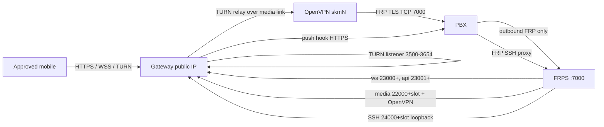

# VPN-Free PBX ↔ Gateway Implementation Plan

**Status:** implementation plan; no production changes made by this document.

## Decision and scope

The target is **no ZeroTier, Tailscale, or other third-party overlay** in the
gateway ↔ PBX path. The existing self-hosted, per-PBX OpenVPN link carried over
FRP is **in scope and is not a provider dependency**: it is a point-to-point
encrypted media link with keys generated by the gateway and no default route.

If "VPN-free" means no OpenVPN process at all, that is a different architecture
(public PBX RTP/TURN endpoints, or a public SIP/media relay). Do not change the
current plan to that model without an explicit decision; it increases the PBX's
public attack surface.

Existing PBXs remain on the legacy path until they are deliberately migrated.
New PBXs use `openvpn-frp`.

## Current state (verified in this repository)

Already present and reusable:

- `scripts/tunnel_media.py` — validated per-PBX OpenVPN-over-FRP media config;
  no office/default route; per-PBX `skm<slot>` interface and private /30.
- `scripts/tunnel_media_material.py` — per-installation CA, client/server certs,
  and `tls-crypt` material.
- `scripts/install-media-link.py` — root-only installer for the media unit.
- `scripts/tunnel-enrollment.py` — allocates media/WS/API ports and returns
  `plan`, `material`, `ports`, FRP and hook credentials.
- `scripts/check-tunnel-readiness.py` — verifies the installed hook and a real
  UDP roundtrip over the media link.
- PBX `lib/gateway-tunnel.js` — redeems the pairing code, installs the media
  link, writes FRPC proxies for `ws`, `api`, `media`, and starts FRPC.
- `scripts/sync-tenant-runtime.py` — can read `/etc/sokrat/media/<pbxId>/plan.json`
  and use `plan.gatewayIp` / `plan.interface` for the tenant TURN relay.

Still provider-coupled or incomplete:

- `install.sh` auto-detects `tailscale0` and writes `GATEWAY_PRIVATE_IP`.
- `sync-tenant-runtime.py` defaults `GATEWAY_PRIVATE_IFACE=tailscale0` and writes
  TURN units with `After=tailscaled.service`.
- `reconcile-tenant-provisioning.py` defaults `DEFAULT_IFACE = "tailscale0"`.
- `provision-tenant-relay.py` and `configure-public-gateway.py` are still
  Tailscale-oriented legacy paths.
- PBX installers unconditionally install/enable ZeroTier and Tailscale
  (`install.sh`, `installer-bundle/install-sokrat.sh`,
  `scripts/safe-upgrade.sh`, `installer-bundle/setup-issabel-asterisk.sh`).
- PBX `sokrat-gateway-readiness.sh` reports a Tailscale IPv4 as required.
- FRP exposes `ws`, `api`, and `media`; there is no VPN-free SSH management
  proxy, so provisioning SSH still depends on a provider/public address.
- Documentation, fixtures, and tests still contain `tailscale0` and `100.64/10`
  assumptions.

## Target architecture



- **Control/API/WS:** PBX initiates outbound FRP TLS to the gateway. No inbound
  provider route and no public PBX API/WS port.
- **Media:** PBX FRPC exposes a loopback OpenVPN server; the gateway OpenVPN
  client connects to the FRPS loopback mapping. RTP stays on the per-PBX `skmN`
  /30; no default route, no LAN route, no provider interface.
- **TURN:** each tenant TURN process listens on the public gateway and relays
  from the PBX-specific media-link gateway IP to the PBX media-link IP. The
  mobile device never receives a private PBX address.
- **Management:** scoped FRP SSH proxy bound to `127.0.0.1` on the gateway; the
  provisioning/onboarding adapter uses that loopback endpoint with a pinned host
  key. No public SSH is required.
- **Push hook:** PBX → gateway over pinned HTTPS; no VPN.

## Contract

### Transport mode

Add one explicit switch:

```text
SOKRAT_TRANSPORT=legacy | openvpn-frp
```

- `legacy`: current Tailscale/ZeroTier behavior; default for existing PBXs and
  upgrade paths.
- `openvpn-frp`: FRP control + SSH, per-PBX OpenVPN media, public TURN listener,
  no provider packages/interfaces/routes.

Fresh gateway installs default to `openvpn-frp`. Existing installations and
safe-upgrade paths remain `legacy` unless explicitly changed.

### Gateway configuration

- `GATEWAY_PUBLIC_HOST` — public gateway address; required.
- `GATEWAY_LISTEN_IP` — public TURN listener; required.
- `GATEWAY_MEDIA_POOL` — per-PBX private /22 pool; default
  `10.253.0.0/22`; validated against local routes.
- `GATEWAY_PRIVATE_IP` / `GATEWAY_PRIVATE_IFACE` — legacy-only; not required and
  not auto-detected in `openvpn-frp`.
- Per-PBX media values come only from the root-installed
  `/etc/sokrat/media/<pbxId>/plan.json`, never from the dashboard.

### Enrollment response

The existing `plan`, `material`, and `ports` contract stays. Add a scoped `ssh`
port to `ports` and to the FRP plugin allowlist. No new public port is opened.

### PBX configuration

- `SOKRAT_TRANSPORT=openvpn-frp` in the PBX installer/settings.
- FRPC proxies: `ws` → 8088, `api` → 8080, `media` → 17001, `ssh` → 22.
- `install-gateway-media-deps.sh` is required; overlay packages are not.
- No provider interfaces, routes, firewall rules, or service enablement.

## Work plan

### Phase 0 — Baseline and contract freeze

1. Inventory provider use on the test gateway and disposable PBX:
   packages, units, interfaces, routes, UFW/cloud rules, and FRP proxies.
2. Capture gateway control, provisioning, runtime manifest, and media plans.
3. Keep all existing PBXs untouched. Use a fresh test gateway + disposable PBX.
4. Freeze the new contract above and add an explicit `legacy` mode so no existing
   path changes by accident.

### Phase 1 — Gateway transport mode and installer

Files: `install.sh`, `.env.example`, `src/control/*`, `PROVISIONING.md`,
`PUBLIC-GATEWAY.md`, `docker/entrypoint.sh`.

1. Add `--transport openvpn-frp|legacy` to `install.sh`; default new installs to
   `openvpn-frp`, require explicit `legacy` for old behavior.
2. Remove `DETECTED_TS_IP`; do not require or write `GATEWAY_PRIVATE_IP` in
   `openvpn-frp`. Keep it only in the legacy branch.
3. Write `SOKRAT_TRANSPORT` and `GATEWAY_MEDIA_POOL` into the gateway environment
   and runtime/provisioning configuration.
4. Validate at install time:
   - OpenVPN >= 2.4, `iptables`, `ip`, `/dev/net/tun`, Python cryptography;
   - media pool does not overlap existing routes;
   - FRPS TLS, enrollment service, and FRP plugin are available;
   - no provider packages are required for this mode.
5. Make the control/API and enrollment paths reject missing transport mode instead
   of silently assuming Tailscale.

### Phase 2 — Per-PBX TURN and media runtime

Files: `scripts/sync-tenant-runtime.py`,
`scripts/reconcile-tenant-provisioning.py`,
`scripts/provision-tenant-relay.py`, `scripts/configure-public-gateway.py`.

1. Read `SOKRAT_TRANSPORT` in `sync-tenant-runtime.py`.
2. In `openvpn-frp`:
   - require a valid `/etc/sokrat/media/<pbxId>/plan.json` for every enabled PBX;
   - take `relayIp` and `mediaIface` from that plan;
   - never fall back to `tailscale0` or the global `GATEWAY_PRIVATE_IP`;
   - emit TURN units with `After=network-online.target` only;
   - add/remove peer UFW rules on the per-PBX `skmN` interface;
   - fail closed if the media plan is missing, mismatched, or stale.
3. Keep the existing legacy branch intact for existing PBXs.
4. Make `provision-tenant-relay.py` and `configure-public-gateway.py` explicit
   legacy-only tools or add a transport guard; the new path should use
   `sync-tenant-runtime.py`.
5. Keep the per-tenant listener ports public as currently allocated; keep relay
   ranges private on the media link.

### Phase 3 — VPN-free management path

Files: `scripts/tunnel-enrollment.py`, `scripts/provisioning-hook-ssh.py`,
PBX `lib/gateway-tunnel.js`, control onboarding/SSH router.

1. Extend `proxy_ports(slot)` with a deterministic `ssh` port, for example
   `24000 + slot` (validate < 65536 and no collisions).
2. Add `ssh` to:
   - `authorize_plugin`'s allowed proxy names and exact remote ports;
   - PBX `frpcConfig` (`localIP=127.0.0.1`, `localPort=22`);
   - enrollment response validation and dashboard status;
   - FRPS loopback-only binding (already `proxyBindAddr=127.0.0.1`).
3. Do not expose the SSH proxy publicly. It must only be reachable on the
   gateway loopback.
4. Provisioning adapter:
   - `sshHost: 127.0.0.1`;
   - `port: <allocated ssh port>`;
   - pinned `knownHostsFile` for that PBX;
   - key-only authentication; no password/ProxyCommand;
   - update the dashboard onboarding path to resolve the loopback proxy while
     still displaying the operator-facing PBX address.
5. Run SSH onboarding only after enrollment approval; pin the host key before
   sending any provisioning material.
6. Alternative if FRP SSH is rejected: expose a restricted public SSH port with
   an explicit operator allowlist. That is less isolated and should be a separate
   decision, not a silent fallback.

### Phase 4 — PBX installer and readiness

Files: PBX `install.sh`, `installer-bundle/install-sokrat.sh`,
`scripts/safe-upgrade.sh`, `installer-bundle/setup-issabel-asterisk.sh`,
`scripts/sokrat-gateway-readiness.sh`, `lib/gateway-tunnel.js`.

1. Add `--transport` / `SOKRAT_TRANSPORT` to PBX installers.
2. In `openvpn-frp`:
   - do not install, enable, or start ZeroTier or Tailscale;
   - do not create `tailscale0`/`zt*` routes or firewall rules;
   - install OpenVPN/iptables/iproute/cryptography;
   - install/start FRPC and the media unit through `gateway-tunnel.js`;
   - keep the push hook and scoped wake path.
3. `sokrat-gateway-readiness.sh`:
   - legacy mode keeps the provider check;
   - `openvpn-frp` checks FRPC, the per-PBX media unit, media-link addressing,
     the push hook, and Asterisk ports; it must not fail on missing Tailscale.
4. `gateway-tunnel.js` status/readiness should expose `transport` and media/FRP
   state; no provider-specific fields in the VPN-free path.
5. Keep legacy defaults for safe upgrades; only fresh PBXs use the new mode.

### Phase 5 — Documentation and tests

1. Update `README.md`, `REVERSE-TLS-ONBOARDING.md`, `VENDOR`/PBX onboarding docs,
   and this plan with the exact new mode and fresh-install command.
2. Replace fixture-only `tailscale0` defaults in new-path tests with media-plan
   fixtures; keep separate legacy regression cases.
3. Add tests for:
   - missing media plan fails closed;
   - `After=tailscaled.service` absent in new TURN units;
   - UFW peer rules use `skmN`, not `tailscale0`;
   - FRP SSH proxy is allowed only on the exact allocated port and loopback;
   - provider packages are not installed in VPN-free mode;
   - existing legacy records still render legacy units.

### Phase 6 — Isolated acceptance

Use a fresh test gateway and disposable PBX only. Do not modify production PBXs,
live gateway records, desktop SIP macros, or existing tenant allocations.

| Test | Required result |
|---|---|
| Provider removal | No `tailscaled`/`zerotier-one`; no `tailscale0`/`zt*` interfaces or routes |
| FRP control | FRPC active; WS/API/media/SSH proxy ports exactly allocated; WS/API reachable |
| OpenVPN media | Media unit active; `skmN` present; no default/office route; UDP roundtrip passes |
| TURN | Public listener allocates; relay uses media link; PBX-only peer rules |
| SSH | Gateway can reach only `127.0.0.1:<sshPort>`; pinned host key; no public SSH |
| Push | FCM wake and SIP bootstrap work |
| Calls | Inbound/outbound answer, two-way audio, hold/transfer, local and remote hangup |
| Restart | Gateway/PBX restart recovers FRP, media, TURN, and SSH |
| Firewall | Only required public ports; no provider rules; media ports private |
| Existing PBX | Unchanged records, approvals, routes, and calls |

Repeat call tests with provider networks deliberately blocked, and capture traffic
showing no provider interface/route is used.

## Rollout

1. Land the feature behind `SOKRAT_TRANSPORT`; keep `legacy` default for existing
   paths.
2. Deploy the isolated test gateway and PBX; complete Phase 6.
3. Add only a new PBX to the production gateway with `openvpn-frp`.
4. Leave existing PBX records, provider services, and interfaces untouched.
5. Keep the isolated test gateway available for rollback comparison.

## Rollback

- Disable the new PBX's FRPC/media/SSH proxy and remove its control record and
  tenant allocation.
- Do not remove provider packages from existing PBXs.
- Restore host firewall/TURN/media files from the timestamped backups created by
  the installer.
- No production change is made until Phase 6 passes.

## Risks and open decisions

- **Self-hosted OpenVPN is still a VPN.** Confirm that the objective is removing
  third-party providers, not all encrypted point-to-point links.
- **FRP SSH is root-level access.** It must remain loopback-only, key-only, with
  pinned host keys and an explicit approval gate.
- **TURN relay/firewall changes can interrupt calls.** Stage and test with no
  active calls; preserve existing allocations.
- **Existing PBXs depend on providers.** Do not migrate or delete them as part of
  the first implementation.
- **Separate security issue:** this workspace contains an ignored Firebase
  service-account JSON under `config/`; ensure it is never committed and treat
  any real key as sensitive outside this plan.
